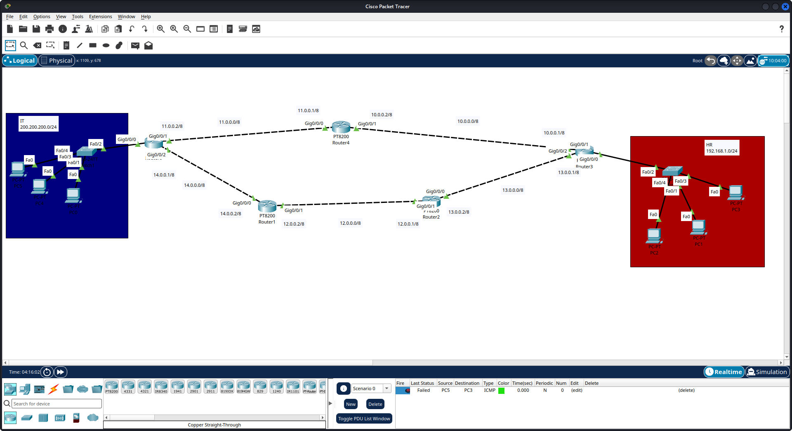

# Access Control List (ACL) Lab

##  Overview
This lab demonstrates the configuration and implementation of Access Control Lists (ACLs) on Cisco routers using Cisco Packet Tracer.

The main objective is to control network traffic by permitting or denying packets based on specified conditions.

##  Objectives
- Understand the concept of Access Control Lists.
- Configure Standard ACLs.
- Configure Extended ACLs.
- Apply ACLs to router interfaces.
- Control traffic using `permit` and `deny` statements.
- Verify ACL configurations and troubleshoot connectivity.

##  Lab Environment
- **Software:** Cisco Packet Tracer
- **Technology:** Cisco IOS
- **Topic:** Network Security – Access Control Lists

##  Network Topology



##  Project Files

| File | Description |
|---|---|
| `Access_Control_List.pkt` | Cisco Packet Tracer lab file |
| `Topology.png` | Network topology diagram |

##  Verification Commands

```bash
show access-lists
show ip access-lists
show ip interface
show running-config
```

##  Key Concepts
- Standard Access Control Lists
- Extended Access Control Lists
- Inbound and Outbound ACLs
- ACL Wildcard Masks
- Traffic Filtering

##  Author
**Magribi**

Network Labs – CCNA 200-301 Practice
