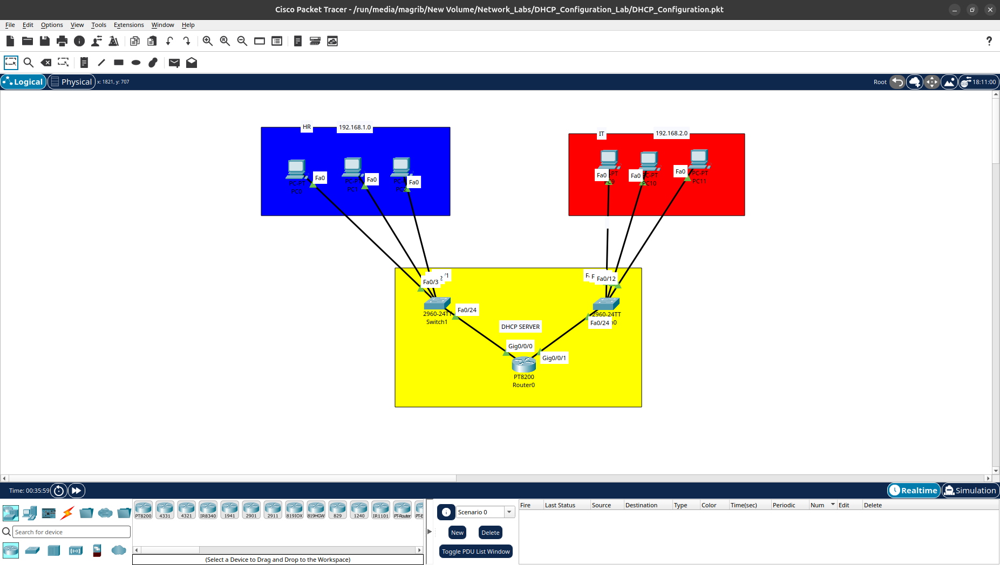

# DHCP Configuration Lab

## Overview
This lab demonstrates how to configure and test DHCP (Dynamic Host Configuration Protocol) using Cisco Packet Tracer.

## Objectives
- Understand how DHCP works.
- Configure a DHCP Server or Router.
- Assign IP addresses dynamically to client devices.
- Verify DHCP functionality.

## Topology

## Lab Files

| File | Description |
|---|---|
| DHCP_Configuration.pkt | Cisco Packet Tracer project |
| DHCP_Configuration.png | Lab configuration screenshot |
| Topology.png | Network topology diagram |

## Verification
Client devices should receive their IP configuration automatically through DHCP.

## Tools
- Cisco Packet Tracer

## Author
Magribi
