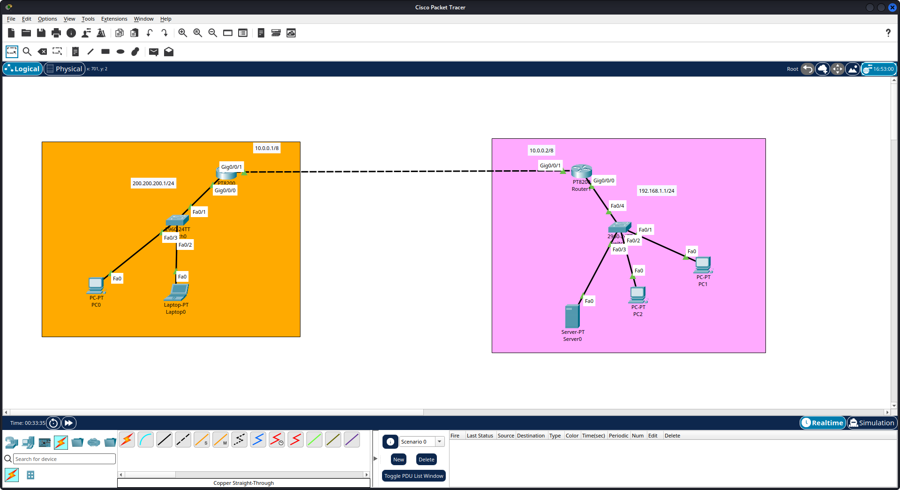

# Extended Access Control List (Extended ACL) Lab

##  Overview
This lab demonstrates how to configure and apply Extended Access Control Lists (ACLs) on Cisco routers using Cisco Packet Tracer.

Extended ACLs provide granular traffic filtering by controlling network traffic based on:
- Source IP Address
- Destination IP Address
- Protocol (TCP, UDP, ICMP, etc.)
- Source Port
- Destination Port

##  Objectives
- Understand how Extended ACLs work.
- Configure Extended ACL rules.
- Permit or deny specific network traffic.
- Apply ACLs to router interfaces.
- Verify ACL functionality using connectivity tests.

##  Lab Files
| File | Description |
|---|---|
| `Extended_Access_List.pkt` | Cisco Packet Tracer lab file |
| `Topology.png` | Network topology diagram |

##  Network Topology



##  Technologies & Tools
- Cisco Packet Tracer
- Cisco IOS
- Extended Access Control Lists
- IPv4 Networking

##  Verification
The following commands can be used to verify the configuration:

```bash
show access-lists
show ip access-lists
show ip interface
show running-config
```

Connectivity testing:

```bash
ping <destination-ip>
traceroute <destination-ip>
```

##  Key Concepts
- Extended ACL Numbered and Named ACLs
- Standard vs. Extended ACLs
- Inbound and Outbound ACLs
- TCP/UDP Port Filtering
- Implicit Deny Rule

##  Author
**Magribi**

GitHub: [@magribi1](https://github.com/magribi1)
