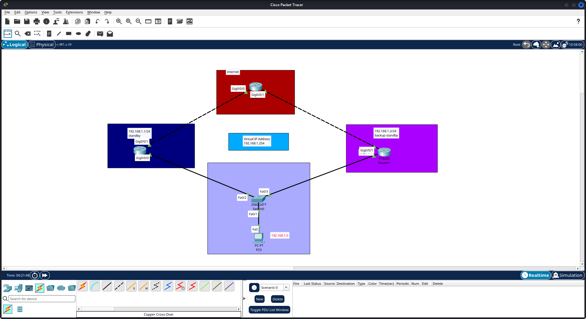

# Redundancy Protocols Lab

##  Overview
This lab demonstrates network redundancy protocols using Cisco Packet Tracer. The main goal is to understand how network redundancy provides high availability and prevents network downtime when the primary gateway fails.

##  Objectives
- Understand the concept of Network Redundancy.
- Configure and test First Hop Redundancy Protocols (FHRP).
- Understand how multiple routers provide gateway redundancy.
- Test failover mechanisms when the active router goes down.
- Verify network connectivity during router failure.

##  Tools & Technologies
- Cisco Packet Tracer
- Routers
- Switches
- End Devices (PCs)
- Redundancy Protocols (FHRP)

##  Network Topology



##  Lab Files

| File | Description |
|---|---|
| `Redundancy_Protocols.pkt` | Cisco Packet Tracer lab file |
| `Topology.png` | Network topology diagram |

##  Practical Tasks
1. Configure the routers and their interfaces.
2. Configure the redundancy protocol.
3. Assign the virtual IP address as the default gateway for end devices.
4. Verify the active and standby routers.
5. Simulate an active router failure.
6. Test automatic gateway failover.
7. Verify connectivity using ping commands.

##  Verification Commands

```bash
show standby brief
show standby
show ip interface brief
show running-config
```

##  Key Concepts
- **FHRP:** First Hop Redundancy Protocol.
- **HSRP:** Hot Standby Router Protocol.
- **Active Router:** The router currently forwarding traffic.
- **Standby Router:** The backup router ready to take over.
- **Virtual IP:** A shared gateway IP address used by end devices.
- **Failover:** The process of switching to a backup router when the active router fails.

##  Author
**Magribi**

GitHub: [magribi1](https://github.com/magribi1)
