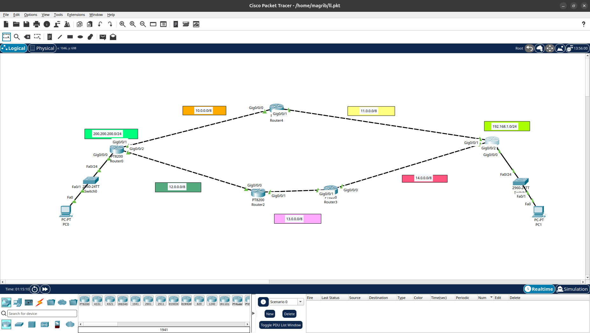

# EIGRP Routing Lab

##  Overview
This lab demonstrates the configuration and implementation of **EIGRP (Enhanced Interior Gateway Routing Protocol)** using Cisco Packet Tracer.

##  Objectives
- Configure EIGRP on Cisco routers.
- Establish EIGRP neighbor relationships.
- Advertise networks using EIGRP.
- Verify routing table entries.
- Understand Administrative Distance (AD).
- Compare EIGRP with RIP routing protocol.

##  Technologies Used
- Cisco Packet Tracer
- Cisco Routers
- EIGRP (AS 1)
- RIP

##  Network Topology



##  Project Files

| File | Description |
|---|---|
| `Routing_EIGRP.pkt` | Cisco Packet Tracer lab file |
| `topology.png` | Network topology diagram |

##  Verification Commands

```bash
show ip protocols
show ip eigrp neighbors
show ip eigrp topology
show ip route
```

##  Key Concepts
- EIGRP Autonomous System (AS)
- Neighbor Adjacency
- Routing Updates
- Administrative Distance
- Dynamic Routing

##  Author
**Ahmed Ehab**

GitHub: [magribi1](https://github.com/magribi1)
