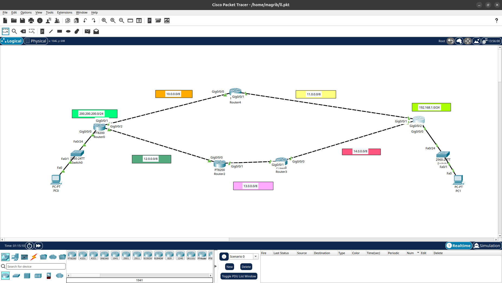

# RIP Routing Lab

##  Overview
This lab demonstrates how to configure **RIP (Routing Information Protocol)** to enable communication between multiple networks using dynamic routing.

##  Objectives
- Understand Dynamic Routing.
- Configure RIP on Cisco routers.
- Advertise connected networks using RIP.
- Verify routing table entries.
- Test connectivity between different networks using Ping.

##  Tools & Technologies
- Cisco Packet Tracer
- Cisco Routers
- Cisco Switches
- RIP (Routing Information Protocol)

##  Network Topology



##  Configuration
- Configure IP addresses on router interfaces.
- Enable RIP routing.
- Advertise network addresses.
- Verify RIP configuration.
- Test end-to-end connectivity.

##  Verification
Use the following commands:

```bash
show ip route
show ip protocols
show running-config
ping <destination-ip>
```

##  Project Files

| File | Description |
|---|---|
| `Routing_RIP.pkt` | Cisco Packet Tracer lab file |
| `topology.png` | Network topology diagram |

##  Author
**Ahmed Ehab**

GitHub: [magribi1](https://github.com/magribi1)
