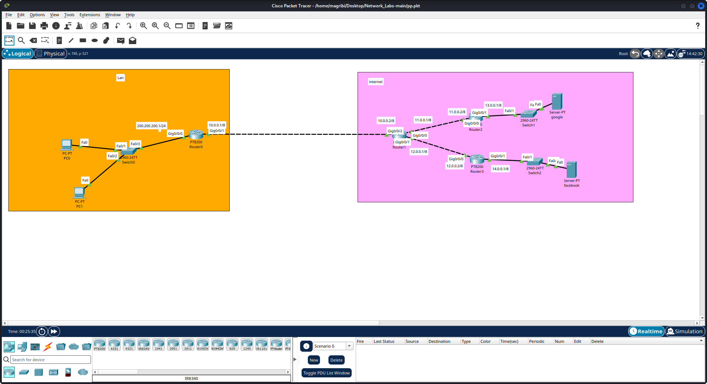

# Static NAT Lab

##  Overview
This lab demonstrates how to configure **Static NAT (Network Address Translation)** on a Cisco router using Cisco Packet Tracer.

Static NAT maps a private IP address to a public IP address manually, creating a permanent one-to-one mapping.

##  Lab Objectives
- Understand how Static NAT works.
- Configure Static NAT on a Cisco router.
- Configure inside and outside NAT interfaces.
- Verify NAT translation.
- Test connectivity between internal and external networks.

##  Tools Used
- Cisco Packet Tracer
- Cisco Router
- PCs and Network Devices

##  Configuration Commands

### 1. Configure Static NAT
```bash
configure terminal
ip nat inside source static <inside-local-ip> <inside-global-ip>
```

### 2. Configure Inside Interface
```bash
interface gigabitEthernet 0/0
ip nat inside
exit
```

### 3. Configure Outside Interface
```bash
interface gigabitEthernet 0/1
ip nat outside
exit
```

### 4. Save Configuration
```bash
end
write memory
```

##  Verification Commands

```bash
show ip nat translations
show ip nat statistics
show running-config
```

##  Network Topology



##  Lab Files

- `Static_NAT.pkt` – Cisco Packet Tracer lab file.
- `Topology.png` – Network topology diagram.
- `README.md` – Lab documentation.

##  Author
**Magribi**

GitHub: [magribi1](https://github.com/magribi1)
