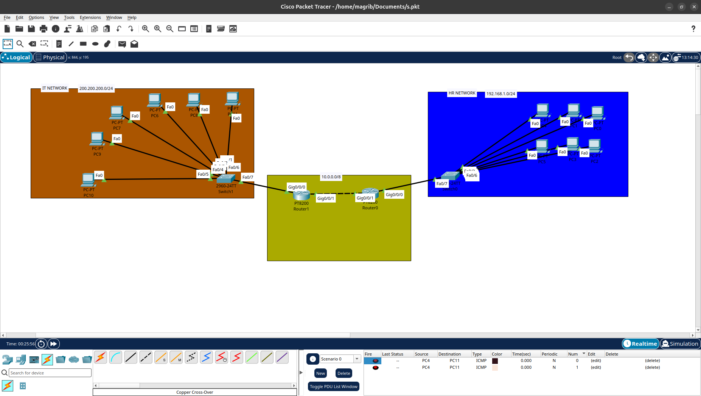

# Static Routing Lab

##  Overview
This lab demonstrates how to configure **Static Routing** using Cisco routers in Cisco Packet Tracer.

The purpose of this lab is to understand how routers communicate with each other and exchange traffic between different networks using manually configured static routes.

##  Objectives
- Configure IP addresses on router interfaces.
- Configure static routes using the `ip route` command.
- Establish communication between different networks.
- Verify connectivity using `ping`.
- Understand how routers forward packets between remote networks.

##  Tools Used
- Cisco Packet Tracer
- Cisco Routers
- Cisco Switches
- End Devices (PCs)

##  Network Topology



##  Lab Files

| File | Description |
|---|---|
| `Static_Route.pkt` | Cisco Packet Tracer lab file |
| `Topology.png` | Network topology diagram |

## Configuration

### Configure Static Routing

```bash
Router(config)# ip route <destination-network> <subnet-mask> <next-hop-ip>
```

### Verify Configuration

```bash
Router# show ip route
Router# show ip interface brief
Router# ping <destination-ip>
```

##  Expected Results
- Successful communication between different networks.
- Correct routing table entries.
- Successful end-to-end connectivity tests.

##  Author
**Magribi**

GitHub: [@magribi1](https://github.com/magribi1)
