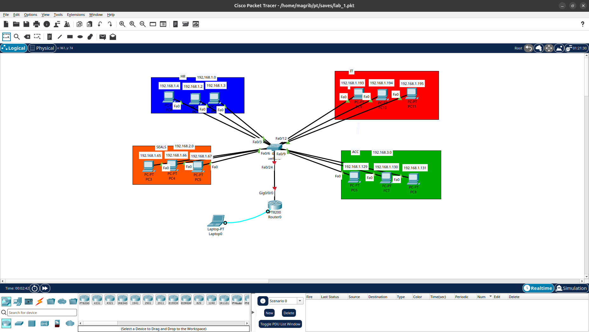

# Subnetting and VLSM Lab

## Overview
This lab demonstrates practical IPv4 Subnetting and Variable Length Subnet Masking (VLSM) using Cisco Packet Tracer.

## Lab Objectives
- Divide a network into multiple subnets.
- Calculate subnet masks and CIDR prefixes.
- Identify network and broadcast addresses.
- Determine first and last usable IP addresses.
- Apply VLSM to allocate IP addresses efficiently.
- Understand IP addressing in a network topology.

## Lab Files

| File | Description |
|---|---|
| `Subnetting_And_VLSM.pkt` | Cisco Packet Tracer lab file |
| `Topology.png` | Network topology diagram |

## Tools
- Cisco Packet Tracer
- IPv4 Subnetting
- VLSM

## Topology

## Skills Practiced
- IPv4 Addressing
- Subnetting
- VLSM
- CIDR
- Network Design

## Learning Path
CCNA 200-301

---
